# Use Case Diagram — SignalNiagaJasaTender

Diagram ini menggambarkan fungsi utama Sistem Manajemen Operasional dan Pelaporan
PT Signal Panca Utama berdasarkan role dan route aplikasi saat ini.

## Aktor

| Aktor | Tanggung jawab utama |
| --- | --- |
| **Admin** | Mencatat data operasional, mengelola data yang dibuat sendiri, dan melihat riwayatnya |
| **Manager** | Meninjau data, menyetujui/menolak pengajuan, serta memantau seluruh laporan |
| **Owner** | Mengawasi seluruh aktivitas, mengelola pengguna/permission, dan melihat laporan |
| **Teknisi** | Menjalankan operasional jasa, memperbarui progres, dan mengajukan kebutuhan material |

## Diagram

> Versi visual yang dapat dibuka di browser tersedia pada
> [`public/usecase.html`](public/usecase.html).

```mermaid
flowchart LR
    admin([Admin])
    manager([Manager])
    owner([Owner])
    teknisi([Teknisi])

    subgraph sistem["Sistem Manajemen Operasional & Pelaporan<br/>PT Signal Panca Utama"]
        direction TB

        auth([Autentikasi & akses berbasis role])
        dashboard([Melihat dashboard])
        laporan([Melihat laporan & filter])
        export([Export laporan PDF / XLSX])

        subgraph tender["Modul Tender"]
            direction LR
            tenderAdmin([Kelola administrasi tender])
            tenderDoc([Kelola dokumen tender])
            rab([Kelola RAB / estimasi])
            proyek([Kelola proyek lapangan])
            evaluasi([Mencatat evaluasi tender])
            kontrak([Konversi tender menjadi kontrak])
        end

        subgraph jasa["Modul Jasa"]
            direction LR
            jasaData([Kelola pekerjaan jasa])
            jasaApprove([Setujui / tolak pekerjaan jasa])
            teknisiData([Kelola teknisi & ketersediaan])
            operasional([Kelola instalasi, maintenance & progres])
            tagihan([Buat tagihan jasa])
        end

        subgraph barang["Modul Perdagangan & Barang"]
            direction LR
            klien([Kelola klien])
            supplier([Kelola supplier])
            pengadaan([Kelola pengadaan & penerimaan])
            produk([Kelola produk & stok])
            penjualan([Kelola penjualan barang])
        end

        subgraph komersial["Dokumen Komersial & Keuangan"]
            direction LR
            penawaran([Kelola quotation])
            order([Kelola customer order])
            invoice([Melihat invoice])
            pembayaran([Catat pembayaran])
        end

        subgraph administrasi["Administrasi Sistem"]
            direction LR
            pengguna([Kelola pengguna & permission])
            audit([Melihat activity log])
        end
    end

    admin --> auth
    manager --> auth
    owner --> auth
    teknisi --> auth

    admin --> dashboard
    manager --> dashboard
    owner --> dashboard

    admin --> tenderAdmin
    admin --> tenderDoc
    admin --> rab
    admin --> proyek
    admin --> jasaData
    admin --> klien
    admin --> supplier
    admin --> pengadaan
    admin --> produk
    admin --> penjualan
    admin --> penawaran
    admin --> order
    admin --> invoice
    admin --> pembayaran
    admin --> laporan

    manager --> tenderAdmin
    manager --> tenderDoc
    manager --> rab
    manager --> proyek
    manager --> evaluasi
    manager --> kontrak
    manager --> jasaData
    manager --> jasaApprove
    manager --> klien
    manager --> supplier
    manager --> pengadaan
    manager --> produk
    manager --> penjualan
    manager --> penawaran
    manager --> order
    manager --> invoice
    manager --> pembayaran
    manager --> laporan
    manager --> export

    owner --> tenderAdmin
    owner --> tenderDoc
    owner --> rab
    owner --> proyek
    owner --> evaluasi
    owner --> kontrak
    owner --> jasaData
    owner --> jasaApprove
    owner --> teknisiData
    owner --> klien
    owner --> supplier
    owner --> pengadaan
    owner --> produk
    owner --> penjualan
    owner --> penawaran
    owner --> order
    owner --> invoice
    owner --> pembayaran
    owner --> laporan
    owner --> export
    owner --> pengguna
    owner --> audit

    teknisi --> teknisiData
    teknisi --> operasional

    tenderAdmin -.->|include| evaluasi
    tenderAdmin -.->|include| tenderDoc
    tenderAdmin -.->|include| rab
    proyek -.->|include| operasional
    jasaData -.->|include| jasaApprove
    jasaData -.->|include| tagihan
    laporan -.->|include| export

    classDef actor fill:#f8fafc,stroke:#0f172a,color:#0f172a,stroke-width:2px;
    classDef usecase fill:#e0f2fe,stroke:#0369a1,color:#082f49;
    classDef boundary fill:#f8fafc,stroke:#475569,color:#0f172a;
    class admin,manager,owner,teknisi actor;
    class auth,dashboard,laporan,export,tenderAdmin,tenderDoc,rab,proyek,evaluasi,kontrak,jasaData,jasaApprove,teknisiData,operasional,tagihan,klien,supplier,pengadaan,produk,penjualan,penawaran,order,invoice,pembayaran,pengguna,audit usecase;
```

## Catatan hak akses

- Data baru yang dibuat Admin masuk ke status **draft/pending** dan diajukan untuk
  persetujuan.
- Manager dapat melakukan approval/rejection pada data yang membutuhkan keputusan.
- Owner berfokus pada monitoring, laporan, activity log, dan administrasi pengguna.
- Diagram mengikuti implementasi route saat ini; beberapa modul mengizinkan
  Manager/Owner membuka halaman operasional, tetapi fungsi input utama tetap
  mengikuti aturan permission aplikasi.
